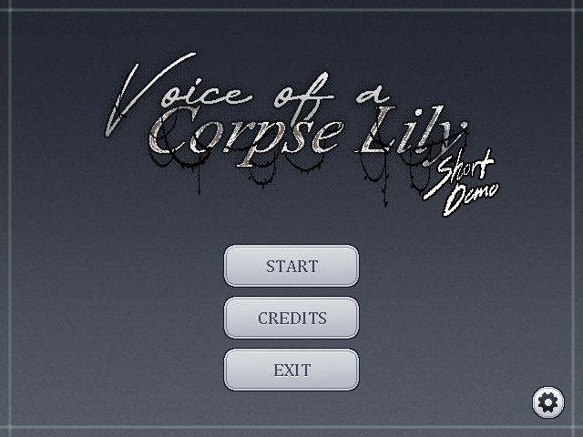

# Voice of a Corpse Lily

*A pixel-art psychological horror adventure about an unsettling day at college.*

## About the Game

Albert James Dimapilis is a first-year college student moving through an ordinary day on campus and beyond. Familiar places and conversations grow increasingly unsettling as intrusive thoughts and shifts in perception blur the line between the everyday and the strange.

## Gameplay

- Follow a connected four-scene story through the classroom, hallway and school exterior, guardhouse and road, then the bedroom and Dream Garden.
- Explore during open sections, speak with characters, and interact with nearby objects and story objectives.
- Experience shifts between Normal and Manifested realities as the story unfolds.
- Read authored dialogue and thought passages presented with a typewriter effect and cinematic transitions.

## Screenshots

The Main Menu artwork above is the available visual preview. Separate gameplay screenshots are not included in the repository.

## Controls

| Action | Controls |
| --- | --- |
| Move during exploration | **WASD** or **Arrow keys** |
| Reveal or advance dialogue | **E**, **Space**, or **Left Click** |
| Interact with a nearby prompted object or character | **E**, **Space**, or click the interaction area |

Movement is available during exploration sections; dialogue and cinematic sequences control their own progression.

## Installation and Running the Project

1. Install **Godot 4.7.2**.
2. In the Godot Project Manager, choose **Import** and select this repository's `project.godot` file.
3. Allow Godot to finish importing project assets, then press **F5** to run the game.

The configured F5 startup opens the Main Menu. Choose **Start** to begin the connected story at Scene 01. The project targets a 1280 × 960 canvas and uses Godot's Forward+ renderer.

## Development Team

| Contributor | Contribution area |
| --- | --- |
| **Prince** | Project lead, gameplay systems, state systems, and integration |
| **Ali** | Opening sequence, user interface, and gameplay integration |
| **Christan** | Environmental dialogue and audio collaboration |
| **Lawrence** | Audio and sound |
| **Isabela** | Visual art, original character artwork, narrative and dialogue, and dialogue UI |
| **Kayla** | Visual art, environments, and map development |
| **Wayne** | Environmental pixel art, including the School Exterior |

## Credits and Third-Party Notices

The bundled **Pixel handwriting** font is by **MissFreakAlice** and is distributed under the [Creative Commons Attribution-ShareAlike 4.0 International License](https://creativecommons.org/licenses/by-sa/4.0/). See [`assets/fonts/ATTRIBUTION.md`](assets/fonts/ATTRIBUTION.md) for the project's attribution record. This font license applies to the font only; it does not license the game's artwork, story, audio, or code.

## Links

- [Pixel handwriting font license (CC BY-SA 4.0)](https://creativecommons.org/licenses/by-sa/4.0/)

No separate store or external download link is listed here.
